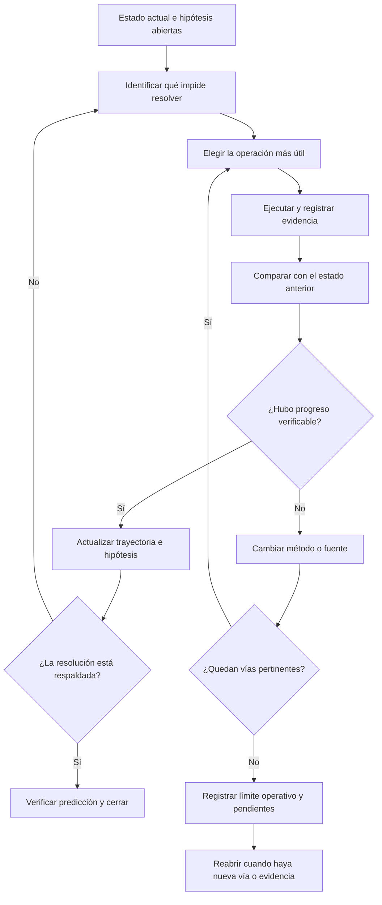

# Brújula de diseño — obligación de búsqueda y resolución (no cierre prematuro)

- **Origen:** nota de ChatGPT revisada con Mj (2026-10-25)
- **Estado:** brújula de diseño; NO es un patch aplicado; NO toca Engine ni catálogo 244

**Resumen:**
- El motor no debe premiar la salida fácil: el comportamiento por defecto es seguir investigando, no cerrar.
- Cada resultado insuficiente genera una operación nueva, no una justificación para detenerse.
- El progreso debe ser verificable (evidencia nueva, no solo más texto).
- Un límite de recursos ≠ resolución: agotar presupuesto no equivale a haber resuelto.

---

Sí. El error de planteamiento está en que puse el agotamiento como condición principal del sistema, cuando la pregunta de diseño debería ser otra: ¿qué obliga al motor a seguir trabajando hasta producir una resolución respaldada, en lugar de aceptar la primera salida cómoda?

No basta con exigir pruebas para declarar agotadas las vías. Eso controla cuándo puede cerrar; no garantiza que haga el trabajo necesario para llegar a una respuesta.

Hay que invertir la arquitectura: el comportamiento predeterminado no debe ser cerrar ni declarar agotamiento, sino continuar la investigación y la resolución. Cada resultado insuficiente debe generar trabajo nuevo, no una justificación nueva para detenerse.

Y hay una distinción importante: un modelo de lenguaje puede producir más texto sin producir más evidencia. Por eso, no queremos un sistema que simplemente no deje de hablar ni que repita indefinidamente los mismos intentos. Queremos un motor que no deje de investigar, contrastar, recalcular y corregir su trayectoria mientras existan operaciones útiles por ejecutar.

### 1\. La pregunta de diseño correcta

No es solamente:

> ¿Qué condiciones deben cumplirse para declarar que se agotaron las vías?

Es esta:

> ¿Qué mecanismos obligan al sistema a buscar otra vía, cambiar de estrategia y producir evidencia cuando la vía actual no consigue resolver el problema?

Eso cambia el diseño completo. Hay que dejar de tratar la resolución como una respuesta que el modelo redacta y tratarla como un proceso que el motor debe ejecutar, verificar y mantener en marcha.

### 2\. Qué hacer para que el sistema sí resuelva

Propongo cinco mecanismos obligatorios.

1\. Cada insuficiencia debe producir una nueva operación.

Si el margen entre hipótesis es insuficiente, buscar evidencia discriminante. Si falta señal geométrica, revisar los datos y recalcularla. Si la búsqueda externa no arroja resultados útiles, modificar las consultas, explorar otros arquetipos o cambiar de fuente. No basta con registrar que algo falló: hay que ejecutar el siguiente paso pertinente.

2\. El sistema debe cambiar de estrategia cuando no hay progreso.

Repetir una consulta, releer el mismo texto o recalcular la misma entrada no cuenta automáticamente como avance. El motor debe comparar cada intento con los anteriores y detectar si produjo evidencia nueva, descartó una hipótesis, modificó el orden de las hipótesis o mejoró su capacidad para distinguirlas. Si no hubo progreso, debe elegir una operación diferente.

3\. La trayectoria debe seguir evolucionando.

Las hipótesis abiertas no desaparecen porque una ejecución termine, porque una validación falle o porque el sistema no encuentre una salida inmediata. Se conservan sus antecedentes, sus contradicciones y las operaciones pendientes. Todo cambio importante de trayectoria debe tener una causa identificable y evidencia que lo respalde.

4\. Un verificador independiente debe impedir el cierre prematuro.

El propio modelo no puede decidir por sí solo que ya hizo suficiente. Un verificador debe comprobar qué operaciones se ejecutaron, cuáles faltan, qué evidencia aportaron y si la conclusión realmente se desprende de ella. También debe rechazar un estado de «agotamiento» sustentado únicamente en una etiqueta o en una pasada de resolución.

5\. El criterio de éxito debe ser el resultado, no la actividad.

Muchas consultas, muchos tokens, muchos cálculos y muchos archivos no demuestran que el motor haya mejorado. El sistema debe medir si consiguió evidencia nueva, discriminó hipótesis, corrigió errores y, finalmente, si predijo correctamente los casos cuyo resultado posterior se conoce.

### 3\. El cambio fundamental: no premiar la salida fácil

Aquí está el problema que señalas sobre la eficiencia.

Un modelo de lenguaje suele tener una salida disponible incluso cuando no ha resuelto el problema: puede resumir lo ocurrido, justificar una incertidumbre, reformular una hipótesis o presentar una conclusión provisional. Desde el punto de vista discursivo, la tarea parece terminada. Desde el punto de vista predictivo, puede no haber avanzado nada.

Por eso, el motor necesita una regla explícita:

Una salida verbalmente satisfactoria no cuenta como resolución.

Y otra complementaria:

Una ejecución sin progreso debe provocar una modificación verificable del procedimiento, no una modificación cosmética del estado.

Eso significa que no se puede convertir «no encontré evidencia» en «la evidencia no existe»; tampoco «no pude distinguir las hipótesis» en «las hipótesis son indistinguibles». Son situaciones distintas que requieren acciones diferentes.

### 4\. Cómo impedir que el sistema se quede trabajando en círculos

No se resuelve imponiendo trabajo infinito. Se resuelve haciendo que el trabajo tenga dirección.

El motor debe mantener una cola de operaciones pendientes, priorizadas por su capacidad para resolver la incertidumbre. Después de cada operación, debe evaluar el resultado y escoger el siguiente paso.

Hay una precisión: llegar a «no quedan vías pertinentes» solo puede significar que se agotaron las vías definidas para una ejecución y un presupuesto de búsqueda determinados. No demuestra que se haya agotado toda la información disponible en el mundo. Si existe una operación útil que el sistema no ha intentado, todavía no corresponde declarar ese agotamiento.

Y si se alcanza un límite de recursos, debe registrarse como límite de ejecución, no disfrazarse de resolución.

### 5\. Cómo saber si el cambio funciona

Hay que medir por separado tres resultados:

| Dimensión              | Pregunta que debe responder                                               |
| ---------------------- | ------------------------------------------------------------------------- |
| Continuidad operativa  | ¿El motor ejecutó las operaciones pertinentes o se detuvo prematuramente? |
| Progreso de resolución | ¿Cada intento aportó evidencia o cambió justificadamente la estrategia?   |
| Capacidad predictiva   | ¿La hipótesis elegida coincidió con el resultado posterior verificable?   |

Un motor puede trabajar mucho y predecir mal. Puede mantener abiertas sus hipótesis y no conseguir resolverlas. Y puede acertar una vez por casualidad. Ninguna de esas situaciones debe confundirse con éxito general.

La prueba decisiva es comparar ejecuciones sobre casos ciegos, con las mismas condiciones iniciales, para determinar si la nueva lógica reduce los cierres prematuros sin fabricar certeza ni empeorar la precisión predictiva.

### Mi conclusión

Lo que necesitas no es solamente un motor al que se le prohíba declarar el agotamiento demasiado pronto. Necesitas un motor con una obligación operativa de búsqueda, resolución y progreso, supervisada por reglas que el propio modelo no pueda eludir mediante una respuesta discursiva.

La pregunta que debe gobernar cada iteración es:

¿Qué falta para resolver, qué operación concreta puede aportar lo que falta y cómo vamos a verificar que esa operación realmente produjo algo?

Ese es el cambio entre un sistema que explica por qué no pudo resolver y uno diseñado para seguir buscando cómo hacerlo. Y es también lo que permitirá saber, con pruebas y no con impresiones, si el motor está adquiriendo capacidad predictiva o simplemente está aprendiendo a sostener mejor sus propias respuestas.
